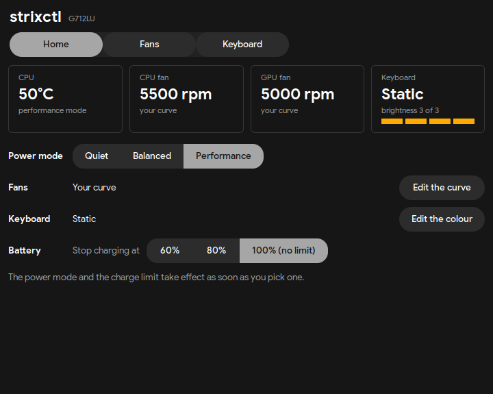
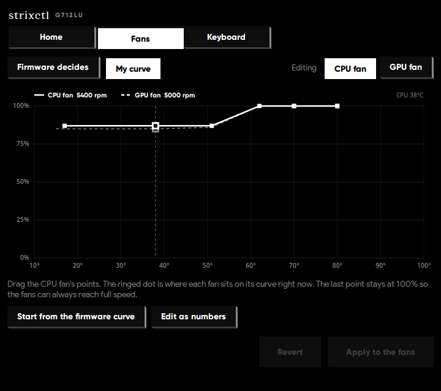
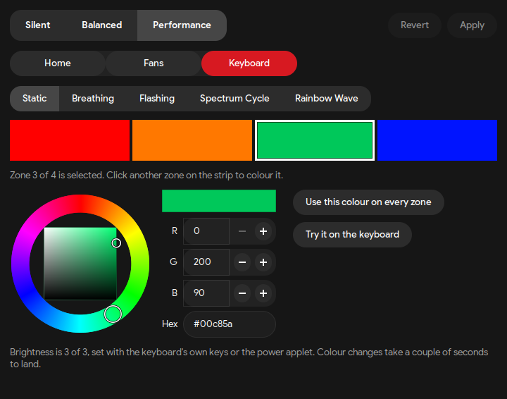

# strixctl

Battery charge limit, fan curves and keyboard backlight for ASUS ROG laptops on
Linux. A small GTK3 app that talks to the kernel's own sysfs interfaces and
looks like the rest of your desktop.

Built and tested on a **ROG Strix G712LU**, Debian 13 (trixie), kernel 6.12,
Cinnamon. Sample size: one laptop. Mine.







## What this is

A vibecoded fun project, built for my own laptop with a lot of help from Opus 5.
It is not a polished product and does not pretend to be one.

It is, though, genuinely used and genuinely tested. Every claim below about what
this hardware does was checked by running it and then staring at the keyboard
like a weirdo, not inferred from a datasheet. Where something is untested, it
says so, because "should work probably" is how you end up filing a bug against
your own EC at 2am.

**Edits are most welcome**: issues, pull requests, or just a note saying what
did or did not work on your model. If you own an ASUS ROG laptop that is not a
G712LU, the single most useful thing you can send is your
`/sys/class/dmi/id/board_name` plus the output of `strixctl colour list`. That
is the whole ask. Two commands. Go on.

## Why another one

There are good tools in this space already, such as [zhelper][zhelper]
(GTK4/libadwaita, ASUS-specific), [batctl][batctl] (TUI/CLI, generic vendor
detection), and [asusctl][asusctl] (the reference implementation, Rust).
strixctl exists because of three gaps:

- **Debian.** asusctl upstream explicitly does not support it, and building it
  means a Rust toolchain plus dev headers. Respectfully: no.
- **Cinnamon/XFCE/MATE.** The tray integration here is XApp, not AppIndicator
  and not a GNOME Shell extension. If your desktop is not the one everybody
  writes tray code for, hi, welcome, this one is for us.
- **No daemon and no root at runtime.** One udev rule hands the sysfs
  attributes to a group you are already in. After that the app is an
  unprivileged process writing integers to files. No background service holding
  privileges, no polkit policy, no D-Bus.

(tl;dr: bro i just wanted to fix the problem i was having instead of trawling
through repos that half-work and allat. anyway. moving on.)

[zhelper]: https://github.com/ixoz/z-helper
[batctl]: https://github.com/Ooooze/batctl
[asusctl]: https://gitlab.com/asus-linux/asusctl

## Install

Prerequisites first, because a freshly installed Debian or Ubuntu has none of
these:

```sh
sudo apt install python3-gi python3-gi-cairo gir1.2-gtk-3.0 gir1.2-xapp-1.0
```

Then:

```sh
git clone https://github.com/TheKimi7/strixctl
cd strixctl
sudo ./install.sh
```

Cannot be bothered with the first step? `sudo ./install.sh --with-deps` will
apt-get the missing ones for you. Either way the installer checks before it
touches anything and tells you exactly what is absent, so you cannot end up
with an installed app that refuses to start. What each package is for is in
[Requirements](#requirements).

**If you already hand-rolled a charge-limit unit, disable it first.** A common
recipe is a oneshot that echoes a hardcoded value into
`charge_control_end_threshold` at boot. strixctl writes the same attribute from
`strixctl-apply.service`, and with no ordering between them the winner is
whichever runs last. Two units, one sysfs file, no referee:

```sh
sudo systemctl disable --now battery-charge-limit.service   # or whatever you named it
```

`install.sh` warns if it finds a unit like that, so you do not have to remember
what past you did.

The installer writes a udev rule and a oneshot service that together grant the
knobs to the `users` group (override with `STRIXCTL_GROUP=`). Both are needed:
udev covers the device-backed attributes, and the service covers
`/sys/firmware/acpi/platform_profile`, which is **not** a udev device on kernels
before 6.14, and there is no `platform-profile` class for a rule to match. Yes,
two mechanisms for one job. Take it up with the kernel.

To put your settings back at login:

```sh
systemctl --user enable --now strixctl-apply.service
```

Uninstall with `sudo ./install.sh --uninstall`. No hard feelings.

## What it controls

| Control | Interface | Status |
| --- | --- | --- |
| Battery charge limit | `BAT*/charge_control_end_threshold` | works |
| Power mode | `/sys/firmware/acpi/platform_profile` | works |
| Fan curves, 8 points × 2 fans | `asus_custom_fan_curve` hwmon | works |
| Fan speeds and CPU temperature | `asus` and `coretemp` hwmon | read-only |
| Keyboard colour: 4 zones, 5 effects, speed | OpenRGB CLI to N-KEY `0b05:1866` | works, needs OpenRGB |

Every one of them is independent. There are no profiles to bundle them into:
the fans know nothing about the keyboard, and setting one never writes the
other. Each has its own page in the window and its own line in the config.

Keyboard **brightness** is not on that list, on purpose. Your desktop already
has a control for it (the Fn keys and the power applet, by way of UPower), and
two controls for one knob only ever disagree. strixctl reads the level the
desktop holds and sends colour changes at that level, and otherwise keeps its
hands off.

### Keyboard colour goes through OpenRGB

The Keyboard page follows Aura Core's layout: an **effect** picker, a **speed**
slider, a row of zone swatches, and a hue-ring colour wheel with R/G/B and hex
fields, with whatever the chosen effect ignores greyed out. Click a zone to
choose what the wheel edits.

Five effects are offered:

```
Static           colour          zoned entry
Breathing        colour, speed   zoned entry
Flashing         colour, speed   per-key entry
Spectrum Cycle   speed           per-key entry
Rainbow Wave     speed           per-key entry
```

The list is filtered against what the hardware actually reports, so an effect
OpenRGB stops advertising disappears from the UI instead of leaving a button
that lies to you.

The per-key entry advertises ten more (Starry Night, Rain, the Reactive family,
Comet, Flash N Dash, Keystone, Direct, Off). They are written for per-key
boards and have not been checked on a 4-zone one, so they are deliberately not
offered rather than offered untested. Shipping a "Starry Night" that does
nothing is worse than not shipping it.

The window shows the five. `strixctl colour --mode` passes any name straight
through, so the untested ones are still reachable if you are feeling brave, and
a name the hardware does not know fails loudly rather than silently:

```sh
strixctl colour ff0000 --mode "Starry Night"    # works, untested here, godspeed
strixctl colour ff0000 --mode "Nonsense"        # Error: Mode not available
```

There is no sysfs path to colour on this chassis. `asus::kbd_backlight` is
brightness only, and nothing under `/sys/class/leds` carries a colour attribute.
Colour means HID writes to the ASUS N-KEY device (`0b05:1866`).

strixctl does not reimplement that protocol. It shells out to
[OpenRGB][openrgb], which already implements it and is maintained by people who
own the hardware. The cost is a subprocess and about two seconds per change; the
benefit is that nobody here is guessing bytes at an embedded controller and
hoping for the best.

The SDK socket was considered and rejected: decoding the controller-data blob is
several hundred lines of variable-length parsing (u16-length-prefixed strings,
mode and zone arrays, protocol-version-conditional fields) against a spec that
does not state its endianness. For a knob that changes now and then,
`subprocess.run` is the better trade. I am not writing a parser for that. You
are not writing a parser for that. Nobody is writing a parser for that.

**Device selection is by name, LED count and advertised effect, never by
index.** Here is the fun part. On the G712LU, OpenRGB reports the one physical
keyboard *six* times, once each on `hidraw1` and `hidraw2` and four times on
`hidraw3`, plus a seventh entry, a per-key `G533ZM` one (also on `hidraw3`),
because it has no G712LU profile of its own (`[G712LU] device capabilities not
found`). One keyboard. Seven entries. It also thinks your laptop is a different
laptop. It is fine. Everything is fine.

Both kinds drive this chassis. They are the same keyboard seen two ways, and the
effect decides which one a write goes to:

- the **4-zone** entries take four independent colours, one per zone, but offer
  only Static, Breathing and Color Cycle;
- the **per-key** entry offers every effect, but a colour list sent there would
  paint the first four *keys* rather than the four zones, so it is used only for
  effects that need at most one colour.

`strixctl colour list` shows the whole picture:

```
z 0: ASUS Aura Keyboard (4 leds, HID: /dev/hidraw1)  per-zone colour, three effects
z 1: ASUS Aura Keyboard (4 leds, HID: /dev/hidraw2)  per-zone colour, three effects
  ...
k 5: G533ZM (83 leds, HID: /dev/hidraw3)  one colour, every effect
```

`./get-openrgb.sh` handles installing it; see [Requirements](#requirements). If
you would rather do it by hand, strixctl searches `PATH` and the usual AppImage
locations, and `openrgb.binary` in `config.json` overrides the search.

You do **not** need OpenRGB's own udev rules for the keyboard: the rule strixctl
installs already grants the N-KEY device to your group, so OpenRGB finds it
without root. (Its other device classes, i2c especially, still want root, which
is what its warning is about. The scary red text is not about you.)

[openrgb]: https://openrgb.org

## Requirements

istg bro this section should be read thoroughly. it is the one that decides
whether any of this does anything at all on your machine.

**Hardware and kernel.** An ASUS ROG laptop whose knobs the kernel already
exposes, which on a current kernel means the `asus_wmi` / `asus-nb-wmi` drivers.
Every one is independent, and strixctl shows a missing one as unavailable rather
than refusing to start:

| Feature | Needs |
| --- | --- |
| Battery charge limit | `BAT*/charge_control_end_threshold` |
| Power mode | `/sys/firmware/acpi/platform_profile` |
| Fan curves | an `asus_custom_fan_curve` hwmon |
| Keyboard colour | an ASUS N-KEY USB device, plus OpenRGB |

**Runtime.** Python 3 and the GTK 3 introspection bindings. Nothing from PyPI,
no virtualenv, nothing to compile, no `node_modules`. The code uses no syntax
newer than f-strings and is developed on Python 3.13.

```sh
sudo apt install python3-gi python3-gi-cairo gir1.2-gtk-3.0 gir1.2-xapp-1.0
```

| Package | Why |
| --- | --- |
| `python3-gi` | PyGObject, the GTK bindings everything is built on |
| `python3-gi-cairo` | Cairo drawing, for the fan curve plot and the colour wheel |
| `gir1.2-gtk-3.0` | the GTK 3 and GDK typelibs |
| `gir1.2-xapp-1.0` | the tray icon only, and imported lazily, so leave it out if you never run `strixctl tray` |

GTK 3 rather than GTK 4 because this targets Cinnamon, whose tray API (XApp) is
GTK 3 only. Not a hill I chose, just the one I live on.

**There is no `requirements.txt`, on purpose.** pip cannot install any of this.
`python3-gi` and `python3-cairo` do exist on PyPI, but only as source builds
wanting a compiler and a pile of `-dev` headers, and the two typelibs are not
Python packages at all: a GObject typelib is a binary description of a C
library, and pip has no concept of one. A `requirements.txt` here would be a
file that looks helpful right up until it fails on a fresh machine, which is
worse than no file.

The apt line above is the dependency list. You do not have to take my word for
it either: `install.sh` probes for each piece before it installs anything and
names exactly what is missing, `sudo ./install.sh --with-deps` fetches them for
you, and running `strixctl gui` without the bindings tells you what to install
rather than throwing a traceback at you. The CLI itself needs nothing but the
standard library, so `strixctl status` works on a box with no GTK at all.

**Optional: [OpenRGB][openrgb]**, needed only for keyboard *colour*. Everything
else works without it. There is a script, so you never have to think about
AppImages or fuse:

```sh
./get-openrgb.sh
```

It downloads a pinned OpenRGB release, checks it against a known SHA-256,
extracts it (Debian 13 ships no libfuse2, so a type-2 AppImage cannot mount
itself) and puts it in `~/.local/share/strixctl/openrgb`, which strixctl
searches on its own. Pass `--here` to put it in `./openrgb` beside the checkout
instead, which is handy when hacking on strixctl; that path is gitignored and
also searched.

The script refuses to run as root, and is kept out of `install.sh` on purpose:
that runs with sudo, and downloading a 33 MB binary and unpacking it as root is
a worse trade than typing one more command. `install.sh` only mentions the
script if it cannot find OpenRGB.

If you would rather install OpenRGB your own way, strixctl looks on `PATH` and
in the usual AppImage locations, or you can point `openrgb.binary` in
`config.json` straight at it.

## Usage

```sh
strixctl status          # every knob, its value, and whether it is writable
strixctl gui             # the control window
strixctl tray            # tray icon
strixctl battery 80      # charge limit; 'off' clears it back to 100%
strixctl power quiet     # power mode; no argument lists them
strixctl apply           # put every saved setting back on the hardware
strixctl fans reset      # hand both fans back to the firmware curve
strixctl fans test       # prove a custom curve actually moves the fans (~1 min)
strixctl fans watch      # live temperature and fan speeds, Ctrl-C to stop
strixctl colour ff0000   # all four zones red
strixctl colour ff0000 ff3c00 ff7800 ffb400 --save   # per zone, and store it
strixctl colour list     # what OpenRGB sees
```

`strixctl status` is the one to run first, and the one to paste into an issue.

Config lives in `~/.config/strixctl/config.json`. Fan speeds in it are
percent, and there is one of everything: one curve per fan, one colour, one
power mode, one charge limit.

Older files are converted the first time they are loaded, and the original is
kept next to it as `config.v1.json` or `config.v2.json`. Version 1 stored fan
speeds as the kernel's 0-255; versions 1 and 2 bundled everything into named
profiles, and the conversion keeps whichever profile was active at the time.

## The window

Three pages. Home shows what the machine is doing right now (CPU temperature,
both fan speeds, the keyboard) and holds the two knobs that belong to the
machine rather than to a page: the power mode and the charge limit. Both take
effect the moment you pick one.

Fans and Keyboard each own their setting outright. Each page has its own Apply
and its own Revert, live only while that page has something unapplied, and
Apply saves and applies that page alone. An unfinished colour never rides
along with a fan curve, and applying a curve never spawns OpenRGB.

## The look

It looks like the rest of your desktop, because nearly all of it is your
desktop. The window takes your GTK theme's widgets, your theme's light or
dark colours and your desktop's font, and brings almost nothing of its own:
a few sizes and weights, so a reading looks like a reading, and one change
of substance.

That change is the accent. A desktop accent is usually a strong blue or
green, and it would otherwise land on Apply, on the chosen option in every
row, on the slider's filled half and on the focus ring. Those are states,
not data, so `theme.py` pulls them back to a grey mixed from your theme's
own foreground and background. There is not a single hex value in the
stylesheet, which is what keeps it right whether your theme is light or
dark.

What is left with a colour in it is the keyboard's own zones, the colour
wheel that sets them, and whatever your theme uses to say something failed.
That is also why the two fan curves are a solid line and a dashed one rather
than two colours.

If you would rather have your desktop's accent back, put this in
`config.json`:

```json
"theme": "system"
```

The sizes stay; only the greys switch off.

## Editing a curve

On the Fans page, pick "My curve", pick which fan, and drag its points on the
graph. "Edit as numbers" opens the same eight points as boxes you can type
into; the two are views of the same numbers, so either updates the other.
Dragging is constrained to the set of curves that pass validation, so a shape
you can draw is always a shape that will apply: each point is held between
its neighbours, and the last point stays at 100% and only moves sideways.

Speeds are percent of full, which is also what the firmware works in. The
kernel exposes them as 0-255 and truncates on the way in and on the way out,
so a curve read back and written again used to lose 1% a point; strixctl
rounds so that the percent you type is the percent the firmware gets.

The graph carries the live readings: both fan speeds in the legend, a dashed
line at the CPU's temperature, and a ringed dot on each curve where that fan
sits right now. With "Firmware decides" selected it shows the firmware's own
curve, read from the machine. If you ever doubt that a curve is doing
anything, `strixctl fans test` holds the fans at 40% and then 75% and checks
that the speeds follow.

"Start from the firmware curve" copies the firmware's real curve for the
power mode the machine is in. Balanced tops out at 83% on this chassis, so the last
point is raised to 100% and the window says so.

The UI will not let you draw something the validator then rejects, because being
told "no" after the fact is deeply annoying.

## Fan curve safety

Custom curves are validated before they are armed: temperatures and speeds
must be non-decreasing, and the last point has to be 100%. The last point
governs every temperature above it, so whatever a curve does lower down, the
fans can still go flat out when it gets hot. Your laptop is not a space heater
and I would like it to stay that way.

Handing the fans back to the firmware (`pwm*_enable = 3`, which also reloads
the firmware's curve for the current power mode) is "Firmware decides"
plus Apply in the window, one item in the tray menu, and `strixctl fans reset`
on the command line. Three escape hatches, because fans are the one thing here
that can actually cook something.

Changing the power mode makes the firmware reload its own curve, so strixctl
re-arms a custom curve immediately afterwards, wherever the change came from:
the window, the tray menu or `strixctl power`. That ordering matters, because
applying the curve first and the mode second silently loses the curve, which
is a genuinely infuriating bug to chase.

A resume from sleep can lose the curve the same way, so the tray puts it back
when the machine wakes. That only works while the tray is running, because
there is still no daemon.

## Known gaps

- Keyboard colour needs OpenRGB installed. Not a hard dependency, and the UI
  tells you rather than just greying out and sulking.
- Each colour change spawns OpenRGB (~2s). If that ever matters, OpenRGB's CLI
  can talk to its own running server with `--client localhost:6742`.
- Re-arming after a resume is the tray's job. Without the tray running, run
  `strixctl apply` yourself.
- CPU TDP tuning needs the `asus-armoury` driver, mainline only from 6.19. So
  that is a "later" problem.
- Tested on exactly one laptop. The backends probe rather than assume, so other
  ROG/TUF models should degrade to "not present" rather than misbehave, but
  "should" is doing heavy lifting in that sentence. Tell me what happens.

## License

MIT. Do whatever you like with it. If your fans get loud, that is between you
and your laptop.
